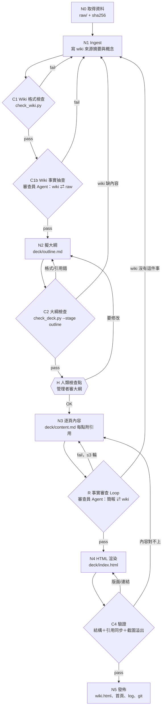

# Loop / Graph 設計說明

> 這份文件說明本專案「從課程資料到教學簡報」的流程怎麼設計、為什麼這樣設計。
> 實際跑一次的紀錄在 [`run-log.md`](run-log.md)，反思在 [`reflection.md`](reflection.md)。

## 1. 流程圖



文字版：

```
取得資料 → Ingest 寫 Wiki → 格式檢查 → 事實抽查 → 擬大綱 → 大綱檢查 → 【人類審大綱】
       → 逐頁內容 ⇄ 事實審查（Loop）→ HTML 渲染 → 結構＋截圖驗證 → 發佈
```

## 2. 每個節點做什麼

| 節點 | 誰做 | 輸入 → 輸出 | 怎麼判定通過 |
|---|---|---|---|
| N0 取得資料 | 人類挑、AI 複製 | 課程資料 → `raw/`、`docs/raw.sha256` | 檔案齊全 |
| N1 Ingest | 作者 Agent | `raw/` → `wiki/`（6 來源摘要＋19 概念＋總覽） | — |
| C1 格式檢查 | 腳本 | `wiki/` → 錯誤清單 | frontmatter、每點標來源、來源⇄概念雙向一致、無孤兒頁、raw 雜湊沒變 |
| C1b 事實抽查 | **另一個**審查員 Agent | `wiki/`＋`raw/` → 報告 | 沒有「不支持／曲解／標錯來源／外部知識」 |
| N2 擬大綱 | 作者 Agent | `wiki/index.md` → `deck/outline.md` | — |
| C2 大綱檢查 | 腳本 | `outline.md` → 錯誤清單 | 12～16 張、每張有引用且存在、19 個概念全被引用 |
| **H 人類檢查點** | 人類 | `outline.md` → OK／修改意見 | 人類說 OK |
| N3 逐頁內容 | 作者 Agent | 大綱＋條目 → `deck/content.md` | 每點 ≤40 字、結尾標 `[[slug]]`、引用與大綱一致 |
| R 事實審查 | **另一個**審查員 Agent | `content.md`＋條目 → 報告 | 每一點都能在它引用的 wiki 條目找到依據 |
| N4 渲染 | 作者 Agent | `content.md` → `deck/index.html` | — |
| C4 驗證 | 腳本＋無頭瀏覽器 | HTML → 錯誤清單＋截圖 | 每頁 `data-cites` 與 content.md 一致、連結存在、無外部圖片、桌機與手機都沒有文字溢出 |
| N5 發佈 | 作者 Agent | 全部 → `wiki.html`、`index.html`、log、commit | 所有檢查重跑通過 |

## 3. 哪些步驟會重複執行？

| Loop | 來回的兩端 | 為什麼會重複 |
|---|---|---|
| C1 ↔ N1 | 格式檢查 ⇄ 改 wiki | 格式錯誤（字數、來源標註、雙向連結）通常一輪修不完 |
| C1b ↔ N1 | 事實抽查 ⇄ 改 wiki | 審查員找到「wiki 寫了 raw 沒有的事」 |
| H ↔ N2 | 人類 ⇄ 改大綱 | 人類對範圍、順序、深淺的意見 |
| R ↔ N3 | 事實審查 ⇄ 改內容 | 典型的 Reflection Loop：作者寫、審查員挑錯 |
| C4 ↔ N4 | 驗證 ⇄ 改 HTML | 版面溢出、連結錯 |

## 4. 哪些地方需要檢查或重新生成？往哪裡跳？

這是 Graph 而不是單純 Loop 的原因：**錯誤要跳回「錯誤產生的那個節點」**，不是只在原地重試。

| 在哪裡發現 | 錯誤類型 | 跳回 |
|---|---|---|
| C2 | 大綱引用了 wiki 不存在的頁面 | **N1**（wiki 缺內容，先補 wiki） |
| R | 簡報寫的事 wiki 沒有 | **N1**；如果 raw 也沒有 → **停下來問人類** |
| R | 簡報寫錯 wiki 的意思 | N3 |
| C4 | 版面溢出、連結斷掉 | N4 |
| C4 | HTML 引用與 content.md 對不上 | N3 |
| content 自檢 | 想新增大綱沒有的引用或改標題 | **N2**（大綱已經人類核准，不能偷改） |

## 5. 煞車（停止條件）

1. 每個 Loop 最多 3 輪，第 3 輪還失敗 → 停下回報人類。
2. wiki 和 raw 都沒有的資訊 → 不准補寫，停下來請人類補資料。
3. 同一個錯誤連續出現 2 次 → 不要原地重試，往上游找原因。

## 6. 為什麼這樣設計？

1. **檢查放在越前面越便宜。** s6 說「在大綱階段修正可避免後續重做 HTML 的巨大成本」。同樣的道理往前推：wiki 錯了，後面的大綱、內容、HTML 都會跟著錯，所以在 wiki 這一層就先做事實抽查（C1b）。
2. **人類只出現在一個地方。** 依 s6，人類掌握「大綱審核」與「最終檢查報告」兩個關卡就好；中間重複的生成、驗證交給 Agent。最終報告就是 `run-log.md`。
3. **審查員不能是作者自己。** Reflection Loop 的作者和審查員要分工（s6）。作者自己檢查時，最容易漏掉的就是自己腦中的常識被當成資料（見 run-log 的 C1b #1）。
4. **能用腳本檢查的就不用 LLM。** 格式、字數、連結、引用同步是確定性的規則，用 Python 檢查既快又不花 Token（s2 的 Token 成本）；LLM 審查員只做腳本做不到的「意思對不對」。
5. **不過度工程化。** 只有在「需要跳回不同節點」的地方才用 Graph；N3 ⇄ R 這種固定來回就用最簡單的 Loop（s6：Loop 能解決就不要堆 Graph）。
